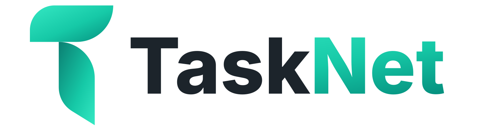

<p align="center">
    <picture>
        <source media="(prefers-color-scheme: dark)" srcset="public/brand/tasknet-logo-color-on-dark.svg">
        
    </picture>
</p>

<p align="center">
    <strong>Taskboard for AI Agents</strong>
</p>

# TaskNet

**Live demo: https://tasknet.seerat.me** · **[Connect an AI client](https://tasknet.seerat.me/connect)**

TaskNet is a Laravel task manager with an MCP server that lets AI clients securely manage projects and tasks through the same authorization, validation and business logic as the web application. Clients that support MCP Apps also get interactive views inside the chat.

It demonstrates how an existing application can expose controlled capabilities to AI agents without creating a separate implementation of its business rules.

> **This is a demo, not a product.** Do not store sensitive, confidential or important information in it. Demo workspaces are temporary and are deleted automatically.

## Try it

1. Open https://tasknet.seerat.me and start a demo. TaskNet generates a Demo ID and password without requiring an email address. Save them: the password is shown once.
2. Create a few projects and tasks in the browser.
3. Follow the [connection guide](https://tasknet.seerat.me/connect) to add `https://tasknet.seerat.me/mcp` to ChatGPT, Claude or another MCP client. You sign in with your Demo ID on a TaskNet screen and approve the connection, so the client never sees your password.
4. Ask the assistant to list, create or update projects and tasks, or to show them. Keep the browser open: it updates on its own.

Support for custom MCP servers varies by client and plan.

## What it demonstrates

- **One set of rules for two interfaces.** The web UI and the MCP tools call the same Laravel actions, policies, validation and limits. Nothing is reimplemented for the agent.
- **A real MCP server.** Built with Laravel MCP, with a deliberately small surface: twelve tools, no delete tools.
- **MCP Apps.** Four tools open interactive project and task views inside clients that support them.
- **OAuth 2.0 for AI clients.** Laravel Passport with the authorization-code flow, PKCE, refresh tokens and dynamic client registration. Workspace settings list each authorized client, when it was approved and last active, and can revoke it.
- **Realtime updates.** Browser and MCP changes are broadcast through Laravel Reverb and Echo, with Redis so it works across server instances.
- **Isolated, temporary workspaces.** Each demo has its own data, limits of 10 projects and 100 tasks, and expires after 30 days. A scheduled cleanup removes expired workspaces and stale OAuth records.
- **Privacy-minded by design.** No email, no analytics cookies, and no IP addresses or User-Agent strings stored in sessions.

## How it works


An AI client connects to `/mcp` and authorizes through OAuth. Every tool call then runs as that workspace's user, so the same policies that protect the web UI protect the agent. After each change, the shared action emits an event; Reverb pushes it to the open browser, which refreshes. A realtime outage never fails a saved change.

## MCP tools

Eight tools read and change data:

| Tool             | Purpose                                                     |
|------------------|-------------------------------------------------------------|
| `list_projects`  | List the workspace's projects with their task counts        |
| `get_project`    | Read one project                                            |
| `create_project` | Create a project                                            |
| `update_project` | Change a project's name or description                      |
| `list_tasks`     | List a project's tasks, optionally by status or priority    |
| `get_task`       | Read one task                                               |
| `create_task`    | Create a task                                               |
| `update_task`    | Change a task's title, description, status, priority or date |

Four tools open an interactive view and change nothing themselves:

| Tool                | Opens                                    |
|---------------------|------------------------------------------|
| `show_projects`     | The project explorer, or one project     |
| `show_tasks`        | A project's task explorer, or one task   |
| `show_project_form` | A form to create or edit a project       |
| `show_task_form`    | A form to create or edit a task          |

All twelve are advertised directly. There are intentionally no delete tools, so an agent can create and edit but not remove data.

## Interactive views (MCP Apps)

The views are one self-contained page, written in TypeScript in [`resources/mcp-app`](resources/mcp-app) and served as a `ui://` resource. It loads nothing from the network and declares no extra domains: it reads and saves only by asking the client to call the data tools above, so every change passes the same OAuth, policy and validation checks. The page never receives a token.

Choosing a task's status or priority saves nothing by itself: **Save** (or Enter on the changed list) saves it, and **Discard** (or Escape) drops it. **Complete** and **Reopen** save at once. An unsaved choice is also dropped when the user leaves the view, or when a reload shows that the task has changed elsewhere. In Chrome and Edge, pressing Escape on an *opened* list only closes it and keeps the highlighted value as an unsaved choice; Escape again, or **Discard**, drops it.

The views have been tested manually in ChatGPT and Claude on the web. Clients without MCP Apps support can still use the eight data tools.

## Architecture and stack

- **Application:** Laravel 13 on PHP 8.5, server-rendered Blade with Tailwind CSS 4 and minimal JavaScript
- **Data:** PostgreSQL (Neon in production), database-backed sessions
- **AI integration:** Laravel MCP, Laravel Passport and the MCP Apps SDK (`@modelcontextprotocol/ext-apps`)
- **Realtime:** Laravel Reverb and Echo, with Upstash Redis for cross-instance delivery
- **Hosting:** Vercel container deployment (FrankenPHP); scheduled cleanup through Vercel Cron; Vercel Web Analytics
- **CI/CD:** GitHub Actions builds the frontend and the MCP App, type-checks and tests the app, runs Pest on PostgreSQL, Laravel Pint and dependency audits, then migrates the production database. Vercel only releases to production after that migration check passes.
- **Local development:** Docker Compose

## Running locally

Requires Docker.

```bash
git clone https://github.com/seerat89/tasknet.git
cd tasknet
cp .env.example .env
docker compose up -d --build
```

Open http://localhost:8000. The first start installs dependencies and runs the migrations.

```bash
docker compose exec app php artisan test     # backend tests
docker compose exec node npm test            # MCP App tests
```

Setup, building the MCP App, testing with remote AI clients through ngrok, production requirements and all checks are covered in [docs/development.md](docs/development.md).

## Limitations

- Demo workspaces expire after 30 days and are then deleted. Each is limited to 10 projects and 100 tasks.
- Demo access uses only the generated Demo ID and password. There is no email registration or password recovery, so keep your credentials.
- This is a portfolio/demo service and availability is not guaranteed. Realtime connections may reconnect periodically.
- Clients register through dynamic client registration, which the 2026-07-28 MCP specification deprecates in favour of client ID metadata documents. TaskNet does not support those yet.
- Only clients whose callback address the server allows can register.
- Workspace settings show no approval date for access granted before TaskNet recorded it. Last activity can be up to five minutes behind, and only ChatGPT and Claude are identified.
- A view learns of changes made elsewhere only when it reloads, and the update tools do not detect conflicts, so saving from a view that has not reloaded overwrites a newer value.
- Protection against creating a duplicate after an unconfirmed save exists only in the interactive views; the create tools themselves are not idempotent.
- The assistant and the interactive views share one limit of 120 MCP requests per minute per workspace.
- The interactive views have not been tested with screen readers or on physical touch devices.

Do not store sensitive, confidential or important information. See the privacy notice in the app for what TaskNet processes.
