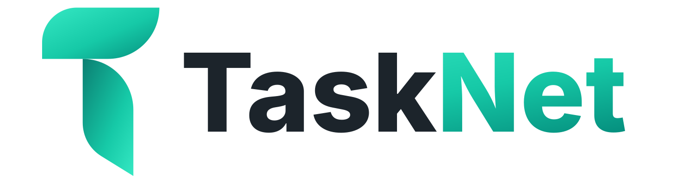

<p align="center">
    <picture>
        <source media="(prefers-color-scheme: dark)" srcset="public/brand/tasknet-logo-color-on-dark.svg">
        
    </picture>
</p>

<p align="center">
    <strong>Taskboard for AI Agents</strong>
</p>

# TaskNet

TaskNet explores how AI agents can work with a Laravel application through MCP while following the same validation, permissions and application rules as the browser interface. It is a small project and task manager with temporary demo workspaces that you can connect your own AI client to.

## What it demonstrates

- A server-rendered Laravel web application for projects and tasks
- An MCP server built with Laravel MCP
- OAuth 2 authorization with PKCE, including dynamic client registration and per-workspace revocation
- Shared actions, policies and limits behind both the web UI and MCP tools
- Progressive MCP tool discovery
- Realtime UI updates with Laravel Reverb and Echo
- Temporary demo workspaces with generated credentials, expiry and scheduled cleanup
- Privacy-conscious session handling: no IP addresses or User-Agent strings are stored in sessions

## How it works

```
Browser   → Laravel UI → shared actions, policies and limits → projects and tasks
AI client → OAuth → MCP server → shared actions, policies and limits → projects and tasks
```

An AI client connects to `/mcp` and authorizes through OAuth on a TaskNet screen, so it never receives the user's password. Every tool call runs as that workspace's user.

## MCP tools

`list_projects`, `get_project`, `list_tasks` and `get_task` are advertised directly. The mutation tools (`create_project`, `update_project`, `create_task`, `update_task`) are reached through `search_tools` and `execute_tools`, which demonstrates progressive tool disclosure. There are no delete tools. Details are in [docs/development.md](docs/development.md#mcp-development).

## Tech stack

Laravel 13 on PHP 8.5 · PostgreSQL · Laravel Passport · Laravel MCP · Laravel Reverb and Echo · Blade and Tailwind CSS 4 · Docker Compose

## Running locally

Requires Docker.

```bash
git clone https://github.com/seerat89/tasknet.git
cd tasknet
cp .env.example .env
docker compose up -d --build
```

Open http://localhost:8000. The first start installs dependencies and runs the migrations. See [docs/development.md](docs/development.md) for details.

## Tests

Pest tests run on in-memory SQLite locally and on PostgreSQL in GitHub Actions CI, which also runs Laravel Pint, a Composer audit and the frontend production build.

```bash
docker compose exec app php artisan test
```

## Status

TaskNet is under development and is not publicly deployed yet.
